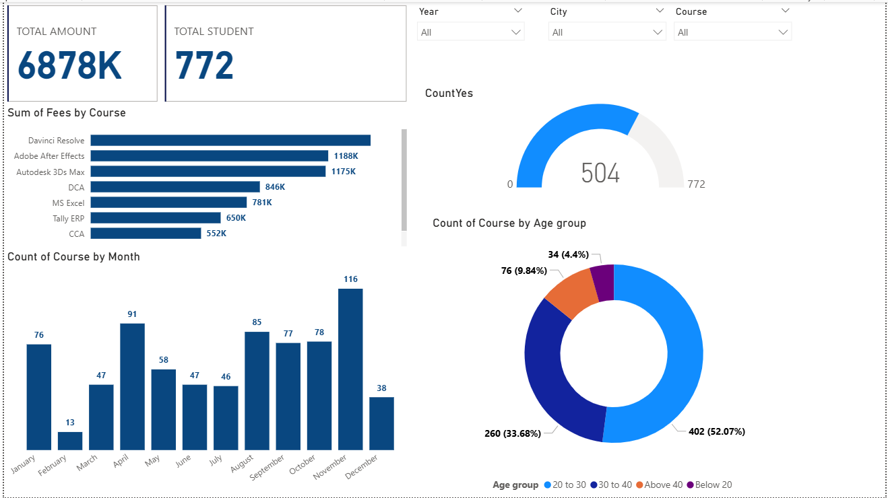

# Student Enrollment & Course Revenue Analytics

## Project Overview

An interactive Power BI analytics dashboard developed to evaluate student enrollment, course revenue, monthly enrollment trends and student demographics within an educational institute.

The project transforms educational data into meaningful business insights to support course planning and institutional performance monitoring.

## Business Objectives

- Monitor student enrollment and course fees.
- Identify high-revenue courses.
- Analyze monthly enrollment trends.
- Understand student age group distribution.
- Explore enrollment patterns across cities, years and courses.
- Support data-driven educational management decisions.

## Tools & Technologies

- Microsoft Power BI
- Data Visualization
- KPI Reporting
- Interactive Slicers
- Business Intelligence

## Dashboard Preview

## Key Performance Indicators

| Metric | Result |
|---|---:|
| Total Course Fees | 6.878 Million |
| Total Students | 772 |
| Highest Monthly Enrollment Count | 116 |
| Largest Student Age Group | 20–30 Years |
| Students Aged 20–30 | 402 |

## Dashboard Features

- Total course fees and student count KPI cards.
- Course-wise revenue analysis.
- Monthly enrollment analysis.
- Student age group distribution.
- Gauge visualization.
- Interactive year, city and course filters.

## Key Business Insights

- November recorded the highest enrollment count of 116.
- February recorded the lowest enrollment count of 13.
- DaVinci Resolve generated the highest course fee amount.
- Students aged 20–30 represent 52.07% of the total student distribution.
- Students aged 30–40 represent 33.68% of the student distribution.
- The dashboard helps identify popular courses and seasonal enrollment patterns.

## Project Workflow

1. Educational dataset collection
2. Data preparation
3. Data analysis
4. KPI development
5. Power BI dashboard creation
6. Interactive filter integration
7. Business insights generation

## Repository Contents

- Educational dataset
- `Student_Enrollment_Analytics.pbix` — Interactive Power BI report.
- `Student_Enrollment_Dashboard.png` — Dashboard preview.
- `README.md` — Project documentation.

## How to Use

1. Download the Power BI report.
2. Open the file using Microsoft Power BI Desktop.
3. Explore the dashboard.
4. Apply year, city and course filters to analyze specific enrollment patterns.

## Skills Demonstrated

- Data Analytics
- Power BI
- Business Intelligence
- Educational Analytics
- Revenue Analysis
- Student Demographic Analysis
- KPI Reporting
- Dashboard Development
- Data Visualization

## Conclusion

This project demonstrates how Power BI can transform educational data into interactive analytical reports that support enrollment monitoring, course performance evaluation and institutional decision-making.

---

**Project Category:** Data Analytics | Education Analytics | Business Intelligence
